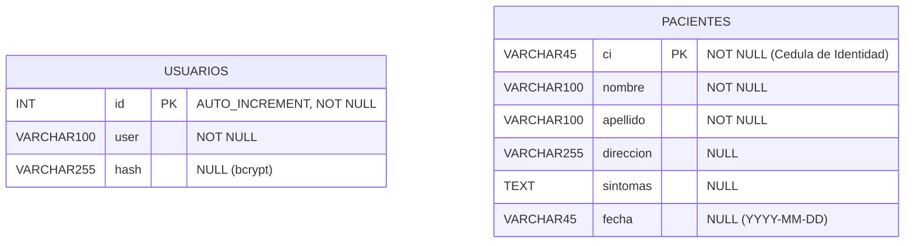

# Diagrama Entidad-Relación — Base de Datos `asic_miranda`

> **Sistema de Gestión de Pacientes — ASIC Miranda**  
> Motor: MySQL (InnoDB) · Charset: `utf8mb4_general_ci`

---

## Diagrama ER

> **Nota:** Las dos entidades son independientes entre sí.  
> `USUARIOS` gestiona el acceso al sistema (autenticación con bcrypt).  
> `PACIENTES` almacena el registro clínico/administrativo de cada paciente.

---

## Descripción de Entidades

### 🔐 USUARIOS

Tabla encargada del control de acceso al sistema. El usuario administrador se inicializa automáticamente al arrancar el servidor Node.js.

| Campo  | Tipo           | Restricción   | Descripción                            |
|--------|----------------|---------------|----------------------------------------|
| `id`   | `INT(11)`      | PK · NOT NULL | Identificador único (autoincremental)  |
| `user` | `VARCHAR(100)` | NOT NULL      | Nombre de usuario (login)              |
| `hash` | `VARCHAR(255)` | NULL          | Contraseña cifrada con bcrypt          |

---

### 🏥 PACIENTES

Tabla principal del sistema. Almacena la información personal y clínica de los pacientes atendidos en ASIC Miranda.

| Campo       | Tipo           | Restricción   | Descripción                               |
|-------------|----------------|---------------|-------------------------------------------|
| `ci`        | `VARCHAR(45)`  | PK · NOT NULL | Cédula de identidad (ej. `V-28491823`)    |
| `nombre`    | `VARCHAR(100)` | NOT NULL      | Nombre del paciente                       |
| `apellido`  | `VARCHAR(100)` | NOT NULL      | Apellido del paciente                     |
| `direccion` | `VARCHAR(255)` | NULL          | Dirección de residencia                   |
| `sintomas`  | `TEXT`         | NULL          | Descripción de síntomas o diagnóstico     |
| `fecha`     | `VARCHAR(45)`  | NULL          | Fecha de registro (formato `YYYY-MM-DD`)  |

---

## Datos de Ejemplo (Semillas Iniciales)

| CI           | Nombre | Apellido | Fecha      | Síntomas                                            |
|--------------|--------|----------|------------|-----------------------------------------------------|
| V-28491823   | Carlos | Mendoza  | 2026-10-15 | Fiebre recurrente, cefalea intensa y dolor muscular |
| V-19827364   | Elena  | Rivas    | 2026-10-17 | Hipertensión arterial, mareos leves matutinos       |
| V-30112459   | Marcos | Silva    | 2026-10-18 | Tos seca persistente y dificultad respiratoria leve |

---

## Notas Técnicas

- La tabla `USUARIOS` **no tiene relación de clave foránea** con `PACIENTES`; el acceso al sistema es independiente del registro clínico.
- El campo `ci` en `PACIENTES` actúa como identificador natural (cédula venezolana).
- El campo `hash` en `USUARIOS` almacena la contraseña procesada con **bcryptjs** (salt rounds: 10).
- Los datos iniciales se cargan desde `dataBase.json` o desde las semillas definidas en `model/pacientes.js` si la tabla está vacía.
